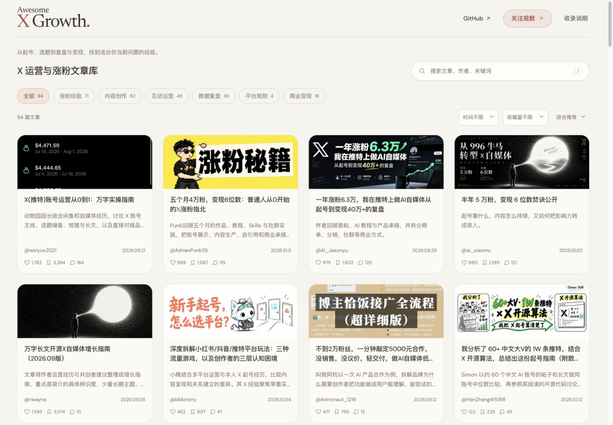

# Awesome X Growth

**有出处的中文 X / Twitter 运营、涨粉与变现资料库。**

[在线文库 →](https://guanmo-ai.github.io/awesome-x-growth/) · [按问题选文章](#遇到什么问题先读哪篇) · [全部目录](docs/CATALOG.md)

从账号定位、持续选题，到互动分发、数据复盘和商业合作，整理创作者亲自做过的事、遇到的坑和调整过程，帮助你找到当前问题的参考。

由 [观默 @guanmo_ai](https://x.com/guanmo_ai) 整理。当前网站收录 126 篇文章，保留作者、原文链接、原图和核验日期。

## 遇到什么问题，先读哪篇？

下表可以直接打开作者原文，无需下载或启动项目。

| 你现在的问题 | 建议先读 | 可以重点看什么 |
| --- | --- | --- |
| 刚开始做 X，不知道如何组织账号 | [动物园园长：X 账号运营从 0 到 1](https://x.com/weiyux2021/status/2101844827599933805) | 确定账号主线，储备选题，让短推与长文配合 |
| 发了很多内容，还是没什么关注 | [Hedy Zhang：做推特两周踩过的 9 个坑](https://x.com/xiaomanhedy/status/2066359010362536146) | 区分曝光和新增关注，复盘哪些内容带来了读者 |
| 写了几天就没有选题 | [微尘印记：为什么别人总有写不完的内容？](https://x.com/weichen_ink/status/2069768243901055184) | 从工作、技能和兴趣中找素材，建立自己的选题库 |
| 有浏览量，但读者不愿意关注 | [Koda：50 天从零到 1 万粉的复盘](https://x.com/wadezone/status/2051707806802469052) | 主页与内容如何承接关注，以及作者已有的经验积累 |
| 粉丝不多，怎样开始接商业合作 | [叫我阿杭：AI 自媒体低粉变现经验](https://x.com/Astronaut_1216/status/2098626905842811336) | 品牌需要什么内容，如何展示场景并完成交付 |
| 想复盘自己的内容和平台收益 | [Aron厚玉：分析自己的推特收益数据](https://x.com/aronhouyu/status/2073283748381306903) | 对齐统计时间和数据口径，分清观察结果与猜测 |

这些是作者的个人经验。阅读时对照其起点、投入和适用条件，再选择一个动作尝试、记录反馈；个案成绩不代表通用的涨粉或收益公式。

## 按主题继续找

[涨粉策略](docs/CATALOG.md#涨粉策略) · [内容创作](docs/CATALOG.md#内容创作) · [互动分发](docs/CATALOG.md#互动分发) · [数据复盘](docs/CATALOG.md#数据复盘) · [商业变现](docs/CATALOG.md#商业变现) · [平台规则](docs/CATALOG.md#平台规则)

也可以阅读 [专题归纳](docs/AI_DIGEST.md)：起号怎么开始、有浏览为什么没关注、持续写什么、怎样走向变现。每个专题关联多位作者的原文，便于比较不同做法。

## 用网站筛选文章

网站首页直接展示原文封面、标题和一句导读。可按主题、时间、收藏量筛选，也可搜索文章、作者或关键词。打开文章后查看原文开头、AI 辅助总结和来源，继续到 X 阅读完整原文。



直接访问 [在线文库](https://guanmo-ai.github.io/awesome-x-growth/) 即可使用。也可以在本地运行，需要 Node.js 20+，无需安装第三方运行依赖：

```sh
git clone https://github.com/guanmo-ai/awesome-x-growth.git
cd awesome-x-growth
npm run dev
```

打开 [127.0.0.1:4186](http://127.0.0.1:4186/)。开发、检查与部署方式见 [开发说明](docs/DEVELOPMENT.md)。

## 推荐文章或参与维护

欢迎推荐你读过的原创经验、具体方法与失败复盘，可以 [提交 Issue](https://github.com/guanmo-ai/awesome-x-growth/issues/new) 并附原文链接、作者和推荐理由。提交数据修改请先读 [贡献指南](CONTRIBUTING.md)。

以 X / Twitter 为重点，保留含实质 X 经验的跨平台比较和通用经营方法；暂缓只讲公众号、小红书等其他平台的专项文章。纯制作技术、泛创业经历和只以涨粉数字包装的文章不收。

站内提供原创导读、有限摘录及来源链接，不附带未授权全文。代码许可证不覆盖第三方文章与配图。详情见 [内容政策](CONTENT_POLICY.md)、[第三方说明](docs/THIRD_PARTY.md)；安全问题见 [安全说明](SECURITY.md)。
